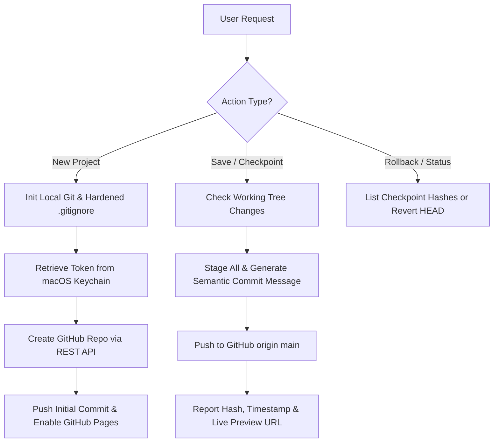

# 🚀 Git Checkpoint & GitHub Lifecycle Engine

## 📌 Overview
The **`git-checkpoint`** skill transforms Git & GitHub into a transparent, zero-friction, cloud **"Save Point / Checkpoint Engine"** across all user projects. It completely eliminates local disk bloat (no duplicate `.html` or `.zip` backup clutter) by persisting the entire project history directly to GitHub Cloud, while also automating project initialization, remote repository creation, and GitHub Pages deployments.



---

## 🎯 When to Trigger
Activate this skill whenever:
1. **New Project Upload**:
   * The user says: *"อัพลง github ที"*, *"สร้าง repo บน github"*, *"upload this to GitHub"*, or *"initialize git and push"*.
2. **Auto-Save / Cloud Checkpoint**:
   * The user says: *"เซฟขึ้น git ที"*, *"checkpoint โค้ด"*, *"autosave"*, *"commit and push"*, or *"สร้างจุดเซฟ"*.
   * **Proactively**: Whenever you complete a meaningful refactoring, feature addition, or bug fix and the user has requested auto-save behavior.
3. **Inspection & Rollback**:
   * The user asks: *"ขอดูจุดเซฟล่าสุด"*, *"ย้อนกลับไปจุดเซฟเดิม"*, *"rollback to previous version"*, or *"undo last change"*.

---

## 🛠️ Step-by-Step Workflows

### 🌟 Mode 1: New Project Inception (`init`)
When a workspace needs to be created on GitHub from scratch:
1. **Run the Initialization Script**:
   ```bash
   ~/.gemini/config/skills/git-checkpoint/scripts/git_checkpoint.sh init "<WORKSPACE_DIR>" "[REPO_NAME]" "[DESCRIPTION]"
   ```
   *(If `REPO_NAME` is omitted, the script automatically generates a clean kebab-case name from the workspace folder).*
2. **What the Script Does Automatically**:
   * Initializes local git branch (`main`).
   * Configures user identity (`{{PRESENTER_NAME}} <{{USER_EMAIL}}>`).
   * Generates a hardened `.gitignore` protecting secrets (`.env`, `*.pem`, `*.key`) and caches (`.DS_Store`, `node_modules/`, `backups/`).
   * Retrieves GitHub Personal Access Token directly from macOS Keychain (`osxkeychain`).
   * Calls GitHub REST API (`POST https://api.github.com/user/repos`) to create the remote repository.
   * Links `origin` and pushes initial commit.
   * If `index.html` is detected: Calls GitHub Pages API (`POST /repos/<user>/<repo>/pages`) to enable hosting and provides the **Live Preview URL**.

---

### 💾 Mode 2: Cloud Auto-Save (`save` / `checkpoint`)
When changes need to be committed and saved to GitHub:
1. **Execute the Save Script**:
   ```bash
   ~/.gemini/config/skills/git-checkpoint/scripts/git_checkpoint.sh save "<WORKSPACE_DIR>" "[COMMIT_MESSAGE]"
   ```
2. **What the Script Does Automatically**:
   * Syncs entrypoints (e.g. `index.html` and standalone `.html` if both exist).
   * Verifies if any files were changed. If clean, skips cleanly.
   * Formats a clear, conventional commit message with timestamp if none provided (e.g. `feat: implement normal vs spastic comparator`).
   * Stages all changes (`git add -A`) and commits.
   * Pushes directly to the remote active branch.
   * Returns:
     - 📌 Short Commit Hash (e.g. `5492049`)
     - 📝 Commit Message
     - 🕒 Timestamp
     - 🌐 Live Preview URL & GitHub Commits Log link

---

### 📊 Mode 3: Checkpoint Inspection (`status`)
To inspect active branch, remote tracking, and recent checkpoints:
```bash
~/.gemini/config/skills/git-checkpoint/scripts/git_checkpoint.sh status "<WORKSPACE_DIR>"
```

---

### ⏪ Mode 4: Rollback & Time Travel (`rollback`)
When the user wants to revert or undo changes:
1. **Rollback by count** (e.g. undo last 1 commit):
   ```bash
   ~/.gemini/config/skills/git-checkpoint/scripts/git_checkpoint.sh rollback "<WORKSPACE_DIR>" "HEAD~1"
   ```
2. **Rollback to specific commit hash**:
   ```bash
   ~/.gemini/config/skills/git-checkpoint/scripts/git_checkpoint.sh rollback "<WORKSPACE_DIR>" "<COMMIT_HASH>"
   ```

---

## 🔒 Security & Best Practices Guardrails

1. **Zero Local Storage Bloat**:
   * Never create `.zip` or duplicate `.html` copies in the project folder. Git already stores compressed delta trees internally and on GitHub Cloud.
2. **Keychain Security**:
   * Passwords and tokens must NEVER be hardcoded into scripts or markdown files. Tokens are retrieved dynamically on runtime via `git-credential-osxkeychain`.
3. **Execution Mode (Sandbox vs Bypass)**:
   * Local inspections and commits can run in standard sandboxed mode.
   * When interacting with GitHub API or running `git push`, use `BypassSandbox: true` so macOS network and keychain access can execute successfully.

---

## 💬 Resumption & User Response Format

When completing a checkpoint, present the save state cleanly to the user:

```markdown
✅ **บันทึกจุดเซฟเรียบร้อยแล้วครับ! (Cloud Checkpoint Saved)**
* 📌 **Commit**: `<short-hash>` — `<message>`
* 🕒 **เวลา**: `YYYY-MM-DD HH:MM:SS`
* 🌐 **Live Preview**: https://<user>.github.io/<repo>/
* 📂 **ดูประวัติเซฟย้อนหลัง**: https://github.com/<user>/<repo>/commits/main
```
