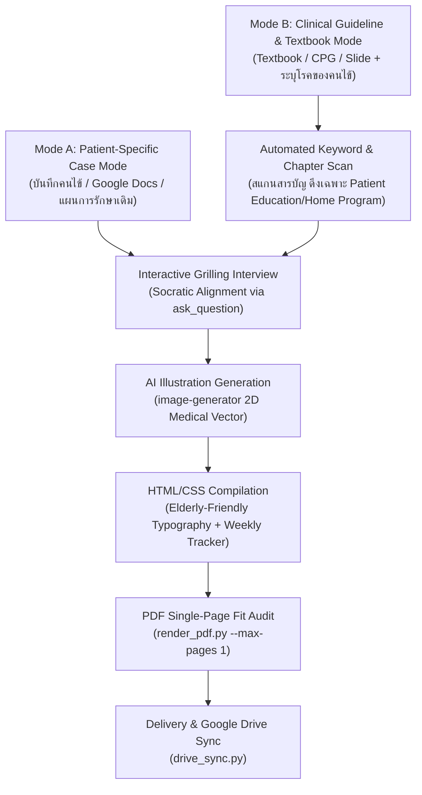

# Patient Guide Maker (`patient-guide-maker`)

A specialized clinical skill for Physical Medicine & Rehabilitation (PM&R), Geriatric Care, and Clinical Outpatient/Inpatient practice. Converts **clinical guidelines, textbook chapters, CPGs, and therapy notes** into **crystal-clear, printable vertical A4 single-page patient guides and high-contrast PDFs** that patients, the elderly, and recovering individuals can easily follow at home safely.

---

## When to Activate
Trigger this skill whenever the user asks:
- "ทำคู่มือคนไข้", "สร้างใบคำแนะนำผู้ป่วย", "ทำเอกสาร A4 ให้คนไข้"
- "สกัด guideline ทำคู่มือคนไข้", "เอาบท textbook นี้มาทำใบแนะนำคนไข้โรค...", "แปลง CPG เป็นคู่มือคนไข้"
- "ทำแผ่นพับคนไข้", "ทำคู่มือกายภาพบำบัดที่บ้าน", "ใบสั่งยาอาหาร/ออกกำลังกายคนไข้"
- "patient guide", "patient handout", "home exercise program", "guideline to patient handout"
- Provides clinical notes, medical textbook/guideline PDFs, or Google Drive links along with a patient diagnosis.

---

## Integrated Medical Knowledge Vaults (คลังความรู้แพทย์ส่วนตัว)

ทักษะนี้เชื่อมต่อกับ **Personal Medical Vaults** ของคุณหมอโดยตรง เมื่อคุณหมอระบุชื่อโรค (แม้ไม่ได้แนบไฟล์ตำรามาด้วย) ระบบจะเข้าไปค้นหาและอ่านข้อมูลสรุปการรักษา ข้อควรระวัง และแนวทางเวชปฏิบัติจากคลังความรู้เหล่านี้เป็นฐานข้อมูลตั้งต้นทันที:

1. **Local Medical Knowledge Vault (คลังสรุปโรคและแนวทางการรักษา):**
   * **Path:** `~/Gemini Antigravity/Hermes Agent/vault/medical/`
   * **หมวดหมู่ย่อย:**
     * `Med/` (193 หัวข้อ: DM, Hypertension, Ischemic stroke, Hyperkalemia, etc.)
     * `Ortho/` (43 หัวข้อ: Fractures, Spine injury, Joint dislocation, etc.)
     * `Sx/`, `Pediatrics/`, `Emergency/`, `ENT/`, `Eye/`, `Ob&Gyn/`, `Psychia/`, `_General/`
2. **Resident PM&R Rehab Vault (คลังเวชศาสตร์ฟื้นฟู {{INSTITUTION}}):**
   * **Path:** `~/Library/CloudStorage/GoogleDrive-{{USER_EMAIL}}/My Drive/Resident Rehab/`
   * **เนื้อหา:** `สรุปRehab/`, `Smile resource/`, `R1/` (สรุป Gait deviations, Stroke rehab protocols, Dysphagia, Prosthetics & Orthotics)

---

## Dual Input Operating Modes

The skill automatically adapts to two primary clinical intake modes:



### Mode A: Patient-Specific Case Mode (โหมดข้อมูลคนไข้รายบุคคล)
* **Input:** บันทึกการรักษาของคนไข้, Discharge summary, บันทึก OPD, หรือ Google Docs ที่มีแผนการรักษาอยู่แล้ว
* **Action:** สกัดคำแนะนำอาหาร การออกกำลังกาย และการใช้ชีวิตมาจัดหน้าเป็นคู่มือทันที

### Mode B: Clinical Guideline & Textbook Mode (โหมดสังเคราะห์จากตำรา/CPG)
* **Input:** ไฟล์ตำราแพทย์ (Textbook PDF), แนวทางเวชปฏิบัติ (CPG), สไลด์บรรยายทางการแพทย์ + **ชื่อโรค/ภาวะของคนไข้** (เช่น *"คนไข้เป็น Osteoarthritis of knee Grade 2"*, *"คนไข้เป็น Parkinson's มีปัญหาเดินติดขัด"*, *"คนไข้เป็น Stroke กึ่งเฉียบพลัน"*)
* **Automated Keyword & Chapter Extraction:**
  * สแกนสารบัญ (Table of Contents) และค้นหา Keyword ของโรคเพื่อดึงเฉพาะบทและหน้าที่เกี่ยวข้องโดยตรง (แม้ไฟล์จะหนา 100–300 หน้า ก็ทำงานได้รวดเร็ว)
  * สกัดเฉพาะส่วน **Patient Education, Home Exercise Program, Dietary Interventions, Lifestyle Modification**
  * สกัด **Contraindications (ข้อห้ามเด็ดขาด)** และ **Red Flags (สัญญาณอันตราย)** ตามหลักฐานเชิงประจักษ์ (Evidence-based)
* **Layman Jargon Translation:** แปลงศัพท์เทคนิคแพทย์ภาษาอังกฤษเป็นภาษาชาวบ้านเข้าใจง่าย 100% พร้อมอุปมาอุปไมยให้เห็นภาพ (เช่น *"เกร็งต้นขาเตะขาตรง"*, *"จังหวะเดินนับ 1-2 ก้าวข้ามสิ่งกีดขวาง"*, *"กินผักดักแป้ง"*)

---

## Mandated Protocol: Interactive Grilling Interview

> [!CAUTION] **MANDATORY Socratic Interview Before Building**
> Do **NOT** skip to generation without grilling the doctor/user first! Walk down the design tree using the `ask_question` tool **one question at a time** to confirm:
> 1. **Core Clinical Priorities (สำหรับ Mode B):** นำเสนอ 3–5 ท่ากายภาพ/คำแนะนำหลักที่สกัดจาก Guideline มาให้คุณหมอเคาะเลือกว่าจะเน้นจุดใด
> 2. **Target Patient Persona & Acuity:** (ผู้สูงอายุทั่วไป, ผู้ป่วย Stroke, ผู้ป่วยข้อเข่าเสื่อม, ผู้ป่วยติดเตียง, คนไข้คลินิกนอก)
> 3. **Document Structure & Sheet Count:** (รวม 1 แผ่น หรือแยก 2 แผ่น เช่น แผ่นกิน + แผ่นออกกำลังกาย)
> 4. **Tone of Voice:** (อบอุ่นให้กำลังใจเหมือนลูกหลานดูแลผู้ใหญ่ vs คู่มือการแพทย์กระชับตรงไปตรงมา)
> 5. **Required Movements / Illustrated Actions:** ยืนยันท่ากายภาพที่ต้องวาดการ์ตูนประกอบ
> 6. **Daily Adherence Tracking:** ระบุช่องติ๊กถูกและค่าวัดใน Weekly Mini Tracker

---

## Design Philosophy & Medical Standards

> [!IMPORTANT] **ELDERLY & REHABILITATION DESIGN STANDARDS**
> 1. **Strict 1-Page A4 Precision:** แต่ละแผ่นต้องพอดี **1 หน้า A4 แบบ 100%** (`@page { size: A4 portrait; margin: 6mm 8mm; }`) ตรวจสอบด้วย `render_pdf.py` เสมอ ห้ามมีเศษข้อความล้นไปหน้าที่ 2
> 2. **High-Legibility Typography:** หัวข้อ 20–24pt, เนื้อหา 15–18pt (ตารางไม่ต่ำกว่า 14pt) ใช้ฟอนต์ไทยหัวมนอ่านง่าย (`Prompt` หรือ `Sarabun`) คอนทราสต์สูง
> 3. **Printer-Friendly Palette:** พื้นหลังสีขาวสะอาดตา (`#ffffff`) ประหยัดหมึกพิมพ์บ้าน ไม่ทำให้กระดาษเปียก หัวข้อสีกรมท่าเข้ม (`#0f2a4a`), ไฮไลท์เขียวมินต์ (`#0d9488` / `#f0fdfa`), และกล่องเตือนภัยสีแดง (`#e11d48`)
> 4. **Mandatory Safety & Contraindications:** ต้องมีกล่อง **"ข้อห้าม/ท่าที่ห้ามทำเด็ดขาด"** และ **"สัญญาณอันตรายที่ต้องหยุดทันที (Red Flags)"** เสมอ
> 5. **Weekly Mini Tracker:** แถบตารางติ๊กถูกประจำสัปดาห์ (จันทร์–อาทิตย์) สำหรับบันทึกความดัน น้ำตาล หรือจำนวนรอบที่ทำสำเร็จ
> 6. **No Heavy Web Portals:** ส่งมอบไฟล์ PDF คุณภาพสูงสำหรับสั่งพิมพ์โดยตรง ไม่สร้างเว็บพรีวิว HTML ให้รกตา

---

## Standard Execution Runbook

### Step 1: Input Ingestion & Clinical Extraction
* **Drive Links:** ค้นหาโฟลเดอร์/เอกสารในเครื่องผ่าน `~/Library/Application Support/Google/DriveFS/*/metadata_sqlite_db`
* **Large Guideline/Textbook PDFs:** ใช้คำสั่ง `pdfplumber` หรือสคริปต์สแกนค้นหาสารบัญและดึงเฉพาะช่วงหน้าที่กล่าวถึงโรคและ Home Rehabilitation ของคนไข้

### Step 2: Interactive Grilling Interview
ใช้เครื่องมือ `ask_question` สัมภาษณ์คุณหมอทีละข้อ จนได้ข้อสรุปที่ตรงกัน (Shared Understanding)

### Step 3: AI Illustration Generation
สั่งการ `image-generator` subagent สร้างภาพการ์ตูนคนไข้/คุณลุง 2D Medical Vector ลายเส้นหนา ชัดเจน พื้นหลังสีขาว 100% ตัวละครมีใบหน้าและชุดสม่ำเสมอกันทุกท่า บันทึกลงในโฟลเดอร์ `assets/`

### Step 4: HTML Template Compilation
เขียนไฟล์ HTML ภายใต้มาตรฐานการพิมพ์ A4:
```html
<style>
  @page { size: A4 portrait; margin: 6mm 8mm; }
  body { font-family: 'Prompt', 'Sarabun', sans-serif; color: #1e293b; background: #ffffff; line-height: 1.3; }
  .page-container { width: 210mm; min-height: 297mm; padding: 8mm 10mm; display: flex; flex-direction: column; justify-content: space-between; }
  @media print {
    html, body { height: 100%; overflow: hidden; background: #ffffff; }
    .page-container { width: 100%; height: 100%; padding: 0; box-shadow: none; }
    .no-print { display: none !important; }
  }
</style>
```

### Step 5: PDF Compilation & Single-Page Verification
แปลง HTML เป็น PDF ด้วยสคริปต์ตรวจสอบ:
```bash
python3 ~/.gemini/config/skills/patient-guide-maker/scripts/render_pdf.py \
  --html "path/to/guide.html" \
  --output "path/to/guide.pdf" \
  --max-pages 1
```
หากสคริปต์แจ้งเตือนว่าหน้าเกิน 1 หน้า ให้ปรับลดระยะห่าง (padding/margins) ทันทีจนกว่าจะได้ `Strict 1-page A4 fit verified!`

### Step 6: Delivery & Destination Confirmation for Google Drive Sync
1. ส่งมอบลิงก์ไฟล์ PDF ที่พร้อมพิมพ์ในแชท
2. **ถามคุณหมอทุกครั้งก่อนอัปโหลดเสมอ:** 
   - ถามว่า *"ต้องการให้อัปโหลดซิงค์เข้า Google Drive ด้วยหรือไม่?"*
   - **และถามตำแหน่งโฟลเดอร์ปลายทางที่ต้องการให้บันทึกทุกครั้ง** (เช่น หน้าแรก My Drive หรือโฟลเดอร์เฉพาะทางใด) **ห้ามตัดสินใจเลือกโฟลเดอร์ปลายทางเองโดยพลการเด็ดขาด**
3. เมื่อคุณหมอระบุตำแหน่งโฟลเดอร์แล้ว ให้เรียกสคริปต์ [drive_sync.py](file://~/.gemini/config/skills/patient-guide-maker/scripts/drive_sync.py) หรือคัดลอกไฟล์ลงโฟลเดอร์ DriveFS ตามที่คุณหมอสั่งอย่างเคร่งครัด

---

## Bundled Utility Scripts
* **`render_pdf.py`**: แปลง HTML เป็น PDF ผ่าน Headless Chrome พร้อมตรวจสอบการันตี 1 หน้า A4 100%
* **`drive_sync.py`**: ถอดรหัส Google Drive URL แล้วคัดลอกไฟล์ลงโฟลเดอร์ DriveFS ท้องถิ่นเพื่ออัปโหลดขึ้น Cloud เบื้องหลังทันที
