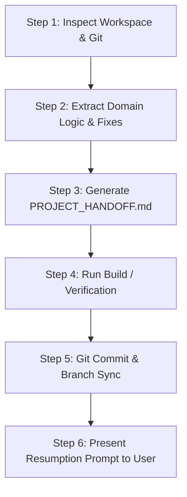

# 📦 Project Handoff & Session Migration Skill

## Overview
This skill enables seamless, zero-loss project migration between different Antigravity chat sessions, separate workspace directories, or different developers/AI assistants. It analyzes the active workspace, git repository, recent chat history, mathematical/domain calibrations, solved edge cases, and user preferences, packaging everything into a clean, standardized `PROJECT_HANDOFF.md` at the project root.

---

## When to Trigger
Activate this skill whenever:
* The user asks for a "project handoff" or "export project context".
* The user wants to start a new chat or move to a new project folder without losing their progress, context, or calibrated equations.
* The user asks: *"how do I continue this in a new project?"* or *"can I export this chat to a fresh session?"*.
* The conversation context is reaching its limit and needs a clean checkpoint before starting a new thread.

---

## 🛠️ Step-by-Step Execution Workflow



### Step 1: Inspect Workspace & Git Environment
Run the bundled context extraction helper or execute inspection commands:
```bash
python3 ~/.gemini/config/skills/project-handoff/scripts/extract_git_context.py "<WORKSPACE_DIR>"
```
Or directly gather:
1. **Git Remote & Branch**: `git config --get remote.origin.url`, `git branch -a`, `git status --short`.
2. **Recent Commits**: `git log -n 5 --oneline`.
3. **Build / Package Tooling**: Read `package.json`, `pyproject.toml`, `Cargo.toml`, or `Makefile`.
4. **Conversation ID**: Note the current Antigravity conversation ID for transcript deep-linking (`conversation://<conversation-id>`).

---

### Step 2: Extract Calibrations, Solved Bugs & Domain Rules
Review the conversation history and code changes to extract:
* **Domain Calibrations & Formulas**: Any specific anatomical angles, physical constants, mathematical matrices, coordinate transforms, or scientific paper citations established during work.
* **Solved Bugs & Regressions Avoided**: Key architectural pitfalls that were fixed and must never be undone (e.g. slider locking issues, matrix order, race conditions, memory leaks).
* **User Rules & Style Guidelines**: Active user preferences (e.g. dark navy / teal themes, typography, vertical A4 infographics).
* **Live Deployment URLs**: Any GitHub Pages, Vercel, Firebase, or cloud URLs currently active.

---

### Step 3: Author the Standard `PROJECT_HANDOFF.md` Document
Write `PROJECT_HANDOFF.md` at the root of the project workspace. Follow this exact structure:

````markdown
# 📋 [Project Name] — Project Handoff

> **To the Next AI Assistant / Developer**:  
> Read this document to immediately inherit the full context, domain calibrations, architectural design, solved edge cases, and repository state of this project.

---

## 📌 Project Overview & Quick Links
* **Repository**: `[Git Remote URL]`
* **Live Demo / Deployment URL**: `[Live URL, e.g. GitHub Pages / Vercel]`
* **Original Conversation**: `[Previous Chat](conversation://<conversation-id>)`
* **Core Mission**: Brief 1-2 sentence description of what the project does and its target audience.
* **Design Philosophy / Clinical References**: Official standards, textbook citations, or style benchmarks.

---

## 🏗️ Technology Stack & Architecture
```
[Annotated directory tree showing key folders and files]
```
### Build, Run & Deploy Commands:
* **Development Server**: `[e.g. npm start / python3 server.py]`
* **Production Build**: `[e.g. npm run build]`
* **Branch Strategy**:
  * `main`: Source code and master branch.
  * `gh-pages` (if applicable): Live deployment branch.
* **Deployment Workflow**:
  ```bash
  [Exact commands to build, commit, merge to gh-pages, and push]
  ```

---

## 🧠 Calibrated Models, Domain Equations & Specifications
*Document all exact numerical constants, formulas, and domain rules calibrated during development.*
* **Component A**: Exact ranges, coordinate systems, and formulas.
* **Component B**: Ratios, kinematic chains, or physical constants.

---

## 🐛 Solved Bugs, Edge Cases & Guardrails (DO NOT REGRESS)
*Bullet points detailing specific bugs fixed and the mechanisms put in place to prevent regressions.*
* **Issue 1**: Symptom $\rightarrow$ Root cause $\rightarrow$ Exact fix implemented.
* **Issue 2**: Edge cases handled.

---

## 🎨 UI/UX & Responsive Architecture
* Color palette codes (primary, secondary, background, text).
* Responsive breakpoints (e.g. mobile drawer auto-collapse $\le 768\text{px}$).
* Key design patterns or accessibility standards applied.

---

## 🎯 Current Project Status & Immediate Next Tasks
1. **Task 1**: Next feature to build.
2. **Task 2**: Follow-up enhancement or optimization.

---

## 💬 Resumption Prompt for the Next Session
> *Copy and paste the prompt below into your new chat to instantly resume work with zero context loss:*
```markdown
I am continuing development on the **[Project Name]** repository. 
Please read `PROJECT_HANDOFF.md` at the project root first to inherit our full architectural design, calibrated domain formulas, solved edge cases, and git deployment pipeline.
Our immediate next objective is: **[Next Immediate Task]**.
```
````

---

### Step 4: Verification & Build
If the project has an automated build or test script (e.g. `npm run build`), run it to verify that everything compiles cleanly and bundle files are fully synchronized.

---

### Step 5: Version Control Sync
1. Stage the handoff document and any updated build artifacts:
   ```bash
   git add PROJECT_HANDOFF.md
   git commit -m "docs: update PROJECT_HANDOFF.md for session migration"
   ```
2. Push to `main`:
   ```bash
   git push origin main
   ```
3. If a separate deployment branch exists (e.g. `gh-pages`):
   ```bash
   git checkout gh-pages && git merge main && git push origin gh-pages && git checkout main
   ```

---

### Step 6: Present to User
Deliver a concise, user-friendly closing response containing:
1. Direct clickable markdown link to [`PROJECT_HANDOFF.md`](file:///path/to/PROJECT_HANDOFF.md).
2. Summary of key assets and domain equations documented.
3. Confirmation of Git remote sync (`main` & `gh-pages`).
4. The ready-to-copy **Resumption Prompt** for their new chat or new project.
